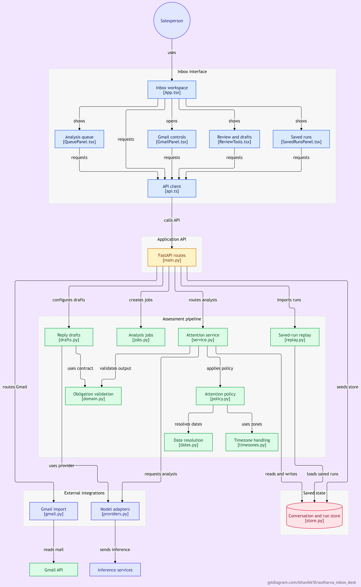

# Inbox Desk · Inbox attention

[](https://gitdiagram.com/bhavikk10/autharva_inbox_desk?utm_source=readme&utm_medium=badge)

Inbox Desk helps a salesperson decide which conversations need attention and why. It reads the full available thread, identifies unanswered requests and commitments, and presents a T1–T4 attention level with source evidence and a suggested next action. Read-only Gmail import also supports everyday inbox conversations beyond sales.

The interface brings the inbox, conversation, assessment and evidence into one screen. Users can change the evaluation time, inspect analysis history, record corrections, sync replies and prepare editable reply drafts. The application does not send email or take actions in Gmail.

## How it works

Messages are normalized with their timestamps, direction, recipients and attachment metadata. A language model extracts an obligation ledger: what remains open, who owns it, whether it is important or urgent, and the message evidence supporting that interpretation.

Application code validates the structured output and source references, resolves raw date expressions against message metadata, counts unanswered outreach, and applies an ordered attention policy. Changing the evaluation time recomputes attention without another model request when the visible conversation is unchanged. Future messages are excluded.

| Attention | Meaning |
|---|---|
| T1 · Immediate | An urgent request, important overdue obligation or missed material commitment needs attention. |
| T2 · Action required | An unresolved action, due-today commitment or eligible stale proposal needs a response. |
| T3 · Monitor | Waiting is appropriate, progress is healthy or an agreed commitment is still in the future. |
| T4 · No attention | No required action remains, or the conversation is irrelevant to the selected policy. |

Semantic judgments are model dependent. A different model may interpret ownership, importance or resolution differently. Source validation makes the result inspectable; it does not establish that the interpretation is correct. Human correction notes remain separate from the original model result.

## Technology and models

| Component | Implementation |
|---|---|
| Interface | React 19, TypeScript, Vite |
| API and analysis pipeline | Python, FastAPI, Pydantic |
| Storage | SQLite for conversations, snapshots and persisted operations |
| Local inference | Ollama with Qwen 3.5 4B (`qwen3.5:4b`) |
| Hosted inference | GLM-4.7-Flash, using a free API account during development |
| Email access | Gmail API with read-only OAuth permissions |

Qwen and GLM produced the current saved assessments. Gemini was also tried and tested, but repeated overload errors on the free-tier account made it unsuitable for the main demonstration. Its adapter remains available. These observations describe the accounts and runs used for this project, rather than a general comparison of model providers.

All analyzers share the same extraction contract. GLM requests run one at a time in FIFO order. An explicitly configured Qwen fallback can handle primary failures; the interface retains the actual provider and primary error. If no provider produces a valid result, the conversation remains unassessed.

## Run locally on Windows

Requires Python 3.11+, Node 22.19+ and Ollama with `qwen3.5:4b` for local inference.

```powershell
.\setup.ps1
.\start.ps1
```

Open **http://127.0.0.1:8000/**. Setup installs dependencies, builds the frontend and creates `.env` from `.env.example` when missing. Keep API keys and OAuth tokens local. If PowerShell blocks a script, use `powershell -ExecutionPolicy Bypass -File .\setup.ps1`, and the equivalent command for `start.ps1`.

Provider selection lives in `.env`; restart the server after changing it. For example:

```dotenv
MODEL_PROVIDER=glm
GLM_MODEL=glm-4.7-flash
GLM_API_KEY=your-key
GLM_THINKING=disabled
ANALYSIS_FALLBACK_PROVIDER=ollama
OLLAMA_MODEL=qwen3.5:4b
PRIMARY_ANALYSIS_BUDGET_SECONDS=90
FALLBACK_TIMEOUT_SECONDS=300
```

Saved assessments can be browsed without a running model. Live analysis and reply generation require the corresponding provider to be available. For frontend development, run `npm run dev` inside `frontend` alongside the FastAPI server; Vite proxies API requests to port 8000.

With no model configured, choose **Browse saved runs** from the availability notice or information menu. The library includes completed runs across models; the normal inbox reuses results matching its configured extraction or recorded fallback. Each assessment shows its actual model and run time. **Analyze again** requests fresh inference; bulk analysis can reuse matching results.

## Deploy on Railway

The root `Dockerfile` builds React and packages it with FastAPI and the current public saved-run bundles. `railway.json` selects Docker and checks `/api/health`. The server listens on Railway's `PORT`, with one worker for the persisted analysis queue.

1. Push these files and deploy from the repository root. Leave custom build and start commands unset; the Dockerfile supplies both.
2. Attach a Railway volume at **`/app/runtime`** and keep **one replica**. It holds SQLite and queue state across deployments; never upload your local `runtime/` or `.env`.
3. Set `MODEL_PROVIDER=glm`, `GLM_MODEL=glm-4.7-flash`, `GLM_THINKING=disabled`, `GLM_MAX_OUTPUT_TOKENS=8192` and `APP_TIMEZONE=Asia/Kolkata`. Leave `ANALYSIS_FALLBACK_PROVIDER` empty: local Ollama is unavailable on Railway.
4. Generate a domain under service **Settings → Networking**. Use target port **8080** unless you set a different `PORT`.

Saved assessments work without an API key through **Browse saved runs**. Live GLM analysis requires `GLM_API_KEY` in Railway Variables. The application is a shared workspace without authentication; restrict access before adding live keys or private mail. Desktop Gmail OAuth remains a local workflow.

## Evaluation

The latest batch has accepted assessments for **78/78 conversations**, using actual model runs and matching saved results: 37 GLM and 41 Qwen. Among 63 pre-specified expected labels, agreement is **58/63**, with zero missed T1 cases and two false T1 cases. Expected labels were fixed before model evaluation; five were user-reviewed and the remaining labels were implementer-authored. Fifteen additional conversations are unlabelled and excluded from agreement metrics.

Development and held-out results remain separate in the [evaluation report](reports/batch78-evaluation.md). The models handled different subsets, so these results are not a head-to-head comparison. They are a small synthetic benchmark, not an estimate of real-inbox accuracy. Review also found an incorrect open obligation despite a matching tier, illustrating why the evidence and obligation ledger matter alongside the label.

## Architecture map

Expand the repository map below, or click it to open the interactive GitDiagram page. The PNG is included in this repository.

<details>
<summary>View architecture diagram</summary>

[](https://gitdiagram.com/bhavikk10/autharva_inbox_desk?utm_source=readme&utm_medium=picture)

</details>

## Project guide

- [Architecture](docs/architecture.md): extraction, validation, dates, policy, storage and failure handling.
- [Workflow](docs/workflow.md): importing, analyzing, reviewing, syncing and using saved assessments.

`backend/` contains the API and pipeline; `frontend/` contains the interface; `data/` holds sample inputs and expected labels; `reports/` holds evaluation artifacts and authentic replay bundles. Private state stays in ignored `runtime/`. Sample inputs are separate from model outputs and do not claim Gmail delivery or import.

Run checks from the project root:

```powershell
python -m pytest -q
cd frontend
npm test
npm run build
```
